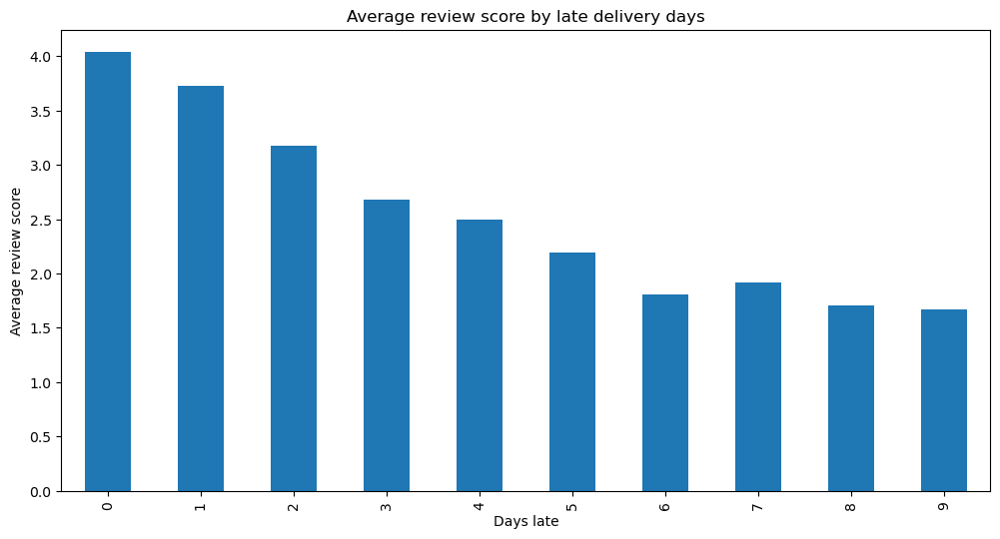
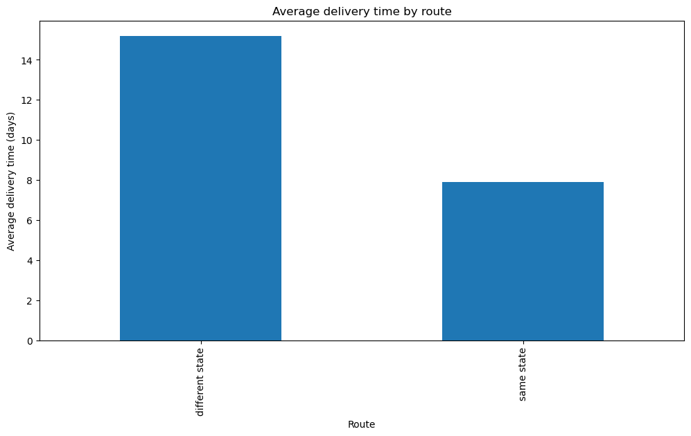
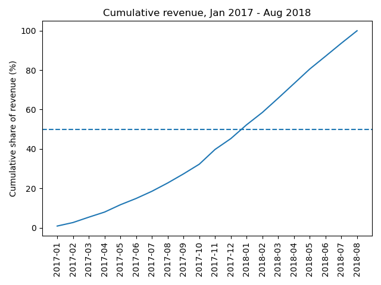

# Olist E-commerce Analysis (SQL + Python)

This project is an analysis of a Brazilian online marketplace called Olist. I analysed delivered orders from January 2017 till August 2018 (96203 orders) since the months outside that range had too few orders. I used SQL and Python to answer several business questions on the revenue growth, category income, delivery time, top sellers, and repeat customers.

- Data: [Brazilian E-Commerce Public Dataset by Olist (Kaggle)](https://www.kaggle.com/datasets/olistbr/brazilian-ecommerce)
- Tools: SQLite, SQL (CTEs, window functions), Python (sqlite3, pandas, matplotlib)
- Full report with all numbers and decisions: [findings.md](findings.md)

## Key findings

1. Late deliveries affect reviews: Orders delivered late are 8.13% of all orders and have an average review score of 2.57/5, compared to 4.3/5 for on time deliveries. This is illustrated in the drastic fall of the average score the later the order is delivered. In fact, orders delivered under 24h late have an average review of 4.04 while this number decreases to 1.71 for orders delivered after 11 days or more.

2. The distance between the seller and the customer is associated with slower delivery: Among single seller orders, orders within the same state take on average 7.9 days to be delivered. On the other hand, orders from different states take on average 15.2 days for delivery.

3. Most revenue came early, then a Black Friday spike: Half of the total business revenue was earned by the end of January 2018 (month 13/20). However, a Black Friday spike occurred in November 2017 with 1176 orders in one day.

4. Most customers buy only once: 97% of customers ordered only once, which suggests retention could be a growth lever.

5. Sales concentration varies by category: The category 'watches_gifts' shows to be very concentrated with the top 3 sellers producing 46.9% of its total revenue (with only 95 sellers in total). The category 'bed_bath_table' is also fairly concentrated (36%). However, this is not the case for the other three top categories as the top three sellers contribute to only 4-6% of the revenue.

## Possible recommendations
- Monitor orders at risk of being more than 2 days late. That is where scores fall fastest.
- Give more realistic delivery estimates for cross-state orders.
- Test retention actions (for example, follow-up offers after a first delivered order).

## Limitations
The results show associations, not causes. Data covers 2017-2018 only. A customer may have bought elsewhere, so a one-time buyer means one order on Olist.

## How to run
1. Install requirements by running : `pip install -r requirements.txt`
2. Download the dataset from Kaggle and put the CSV files in `data/raw/`.
3. Run `python load_db.py` to build the SQLite database.
4. Open `analysis.ipynb` or run the queries in `sql/`.